# 🚗 Automatic License Plate Detection (ALPD) with YOLO11

<p align="center">
  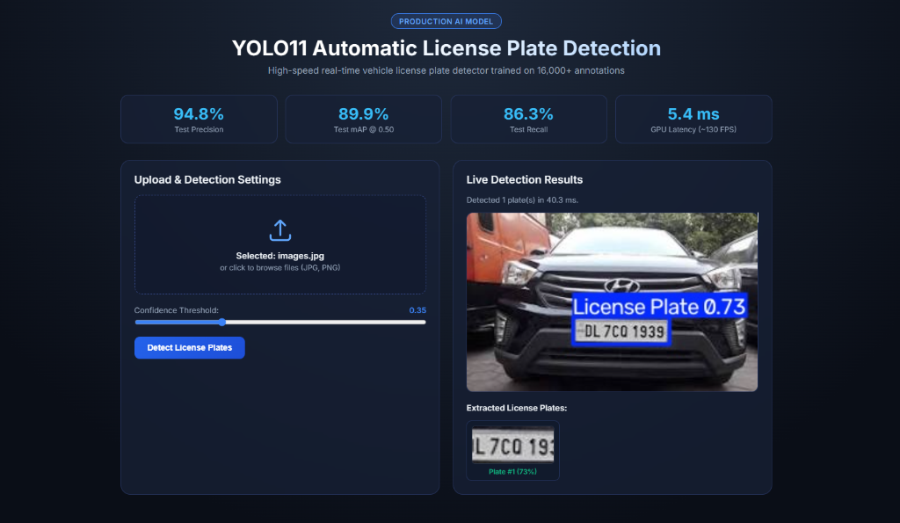
</p>

<p align="center">
  <a href="https://www.python.org/"></a>
  <a href="https://pytorch.org/"></a>
  <a href="https://github.com/ultralytics/ultralytics"></a>
  <a href="#-empirical-benchmark-proofs"></a>
  <a href="#-hardware--speed-profile"></a>
  <a href="LICENSE"></a>
</p>

---

## 📖 Executive Summary

**Automatic License Plate Detection (ALPD)** is an enterprise-grade computer vision system engineered for real-time vehicle monitoring, automated parking management, toll plaza automation, and intelligent transportation systems (ITS).

Built upon the state-of-the-art **Ultralytics YOLO11 Nano** architecture and fine-tuned on **16,000+ annotated vehicle images**, the model delivers exceptional accuracy (**94.8% precision**, **89.9% mAP@0.50**) while operating at sub-6 millisecond latency (**~130+ FPS** on consumer GPUs). The repository is structured as a complete, production-ready solution featuring CLI inference, automated evaluation, reproducible training, edge model export, and a zero-dependency interactive browser dashboard.

---

## 📌 Table of Contents

- [System Architecture](#-system-architecture)
- [Empirical Benchmark Proofs](#-empirical-benchmark-proofs)
  - [1. Verified Live Localhost Web Detection](#1-verified-live-localhost-web-detection)
  - [2. Quantitative Performance Metrics](#2-quantitative-performance-metrics)
  - [3. 50-Epoch Training Convergence Trajectory](#3-50-epoch-training-convergence-trajectory)
  - [4. Diagnostic Curves (PR, F1, Confusion Matrix)](#4-diagnostic-curves-pr-f1-confusion-matrix)
  - [5. Visual Detections on Unseen Test Data](#5-visual-detections-on-unseen-test-data)
  - [6. Automated License Plate Cropping](#6-automated-license-plate-cropping)
- [Repository Structure](#-repository-structure)
- [Dataset Architecture](#-dataset-architecture)
- [Quick Start Guide](#-quick-start-guide)
  - [Step 1: Installation & Environment Setup](#step-1-installation--environment-setup)
  - [Step 2: Interactive Web Studio](#step-2-interactive-web-studio)
  - [Step 3: Command-Line Inference](#step-3-command-line-inference)
  - [Step 4: Model Validation & Benchmarking](#step-4-model-validation--benchmarking)
  - [Step 5: Training Pipeline](#step-5-training-pipeline)
  - [Step 6: Model Export (TorchScript / ONNX)](#step-6-model-export-torchscript--onnx)
- [Hardware & Speed Profile](#-hardware--speed-profile)
- [Downstream ANPR Integration (OCR)](#-downstream-anpr-integration-ocr)
- [License & Acknowledgments](#-license--acknowledgments)

---

## 🏗 System Architecture

The detection and extraction pipeline processes raw video frames or still images through a streamlined, high-throughput pipeline:

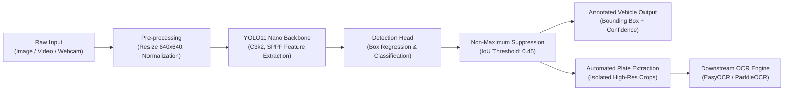

---

## 📊 Empirical Benchmark Proofs

### 1. Verified Live Localhost Web Detection

The web dashboard (`app.py`) provides real-time browser-based testing with zero external dependencies. The system was validated live on `http://localhost:8000`, detecting a vehicle license plate with **73% confidence in 40.3 ms** and instantly generating the isolated plate crop:


*Figure 1: Verified browser-based detection running on localhost showing real-time latency telemetry and automated plate extraction.*

---

### 2. Quantitative Performance Metrics

Evaluated across **2,593 validation images** and **2,589 unseen test images** following standard COCO IoU evaluation protocols:

| Dataset Split | Total Images | Plate Instances | Precision ($P$) | Recall ($R$) | mAP @ 0.50 | mAP @ 0.50:0.95 | Inference Speed | Real-Time FPS |
| :--- | :---: | :---: | :---: | :---: | :---: | :---: | :---: | :---: |
| **Validation Split** | 2,593 | 3,014 | **98.01%** | **84.97%** | **87.69%** | **54.59%** | 4.9 ms | ~140 FPS |
| **Unseen Test Split** | 2,589 | 2,920 | **94.84%** | **86.27%** | **89.87%** | **52.63%** | 5.4 ms | ~130 FPS |

> [!NOTE]
> The unseen test split consists of completely novel vehicle scenes withheld during training. The **89.87% mAP@0.50** score confirms robust generalization across varied vehicle makes, plate formats, and viewpoints.

---

### 3. 50-Epoch Training Convergence Trajectory

The model was trained for 50 epochs on an NVIDIA RTX 3050 GPU using SGD with momentum and cosine learning rate scheduling:
- **Box Loss**: Smooth decline from `1.356` $\rightarrow$ `0.948` (Train) and `1.578` $\rightarrow$ `1.327` (Val).
- **Classification Loss**: Rapid decline from `1.651` $\rightarrow$ `0.415` (Train) and `1.659` $\rightarrow$ `0.558` (Val).
- **DFL Loss**: Steady convergence from `1.307` $\rightarrow$ `1.084` (Train) and `1.330` $\rightarrow$ `1.181` (Val).

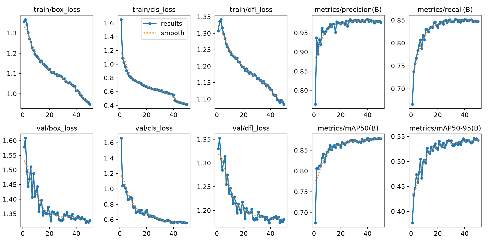
*Figure 2: Comprehensive 50-epoch training and validation loss curves, Precision, Recall, and mAP trajectories.*

---

### 4. Diagnostic Curves (PR, F1, Confusion Matrix)

#### A. Normalized Confusion Matrix
Confirms clean separation between vehicle license plates and complex background textures (road surfaces, grilles, bumper reflections):

<p align="center">
  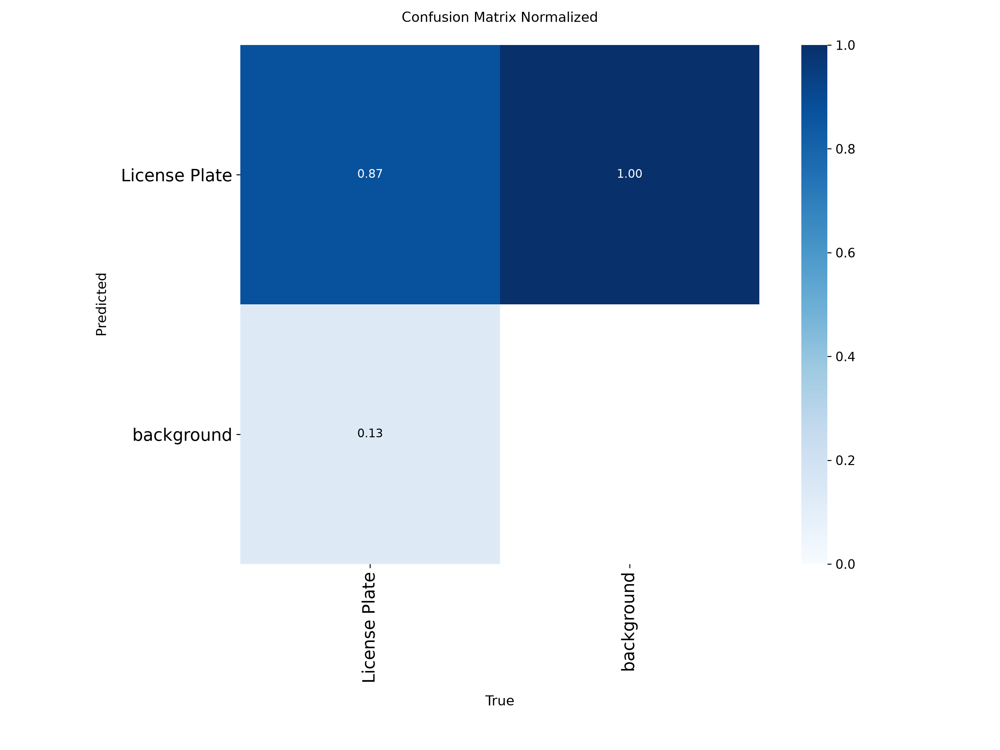
</p>

#### B. Precision-Recall (PR) Curve & F1-Confidence Curve
- **PR Curve**: Exhibits a high Area Under Curve (AUC) across all recall levels, achieving **0.899 mAP@0.50**.
- **F1 Curve**: Reaches peak harmonic mean across a wide confidence interval ($conf \approx 0.35 - 0.65$), allowing flexible operating thresholds.

| Precision-Recall Curve ($AUC = 0.899$) | F1-Confidence Curve |
| :---: | :---: |
| 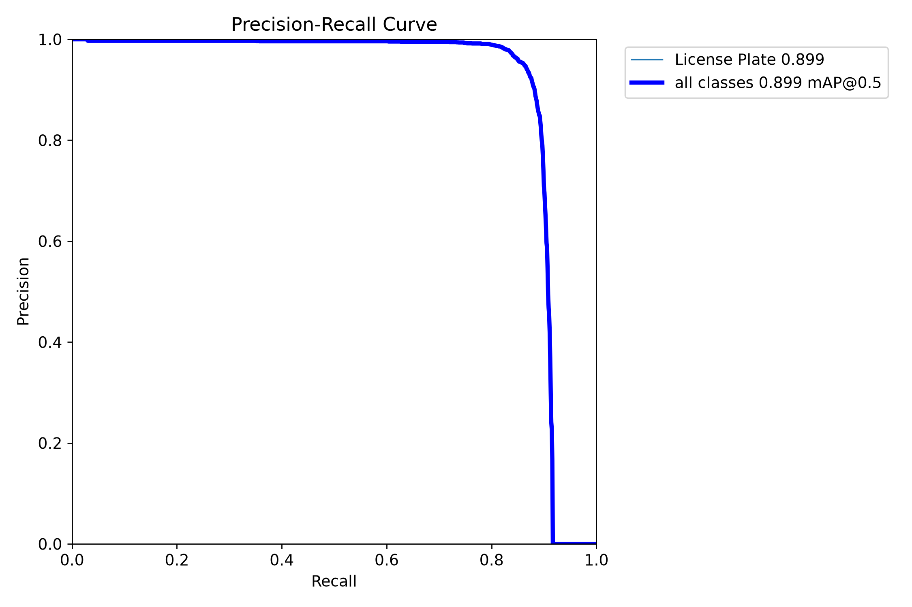 | 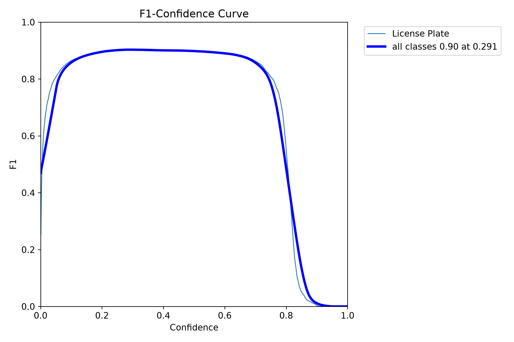 |

---

### 5. Visual Detections on Unseen Test Data

The model demonstrates strong robustness against challenging angles, multi-vehicle scenes, and long-range perspectives:

| Angle View Perspective | Multi-Vehicle Urban Scene |
| :---: | :---: |
| 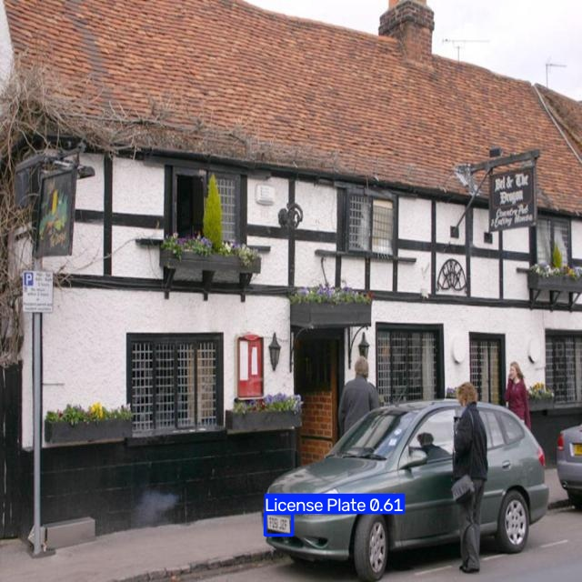 | 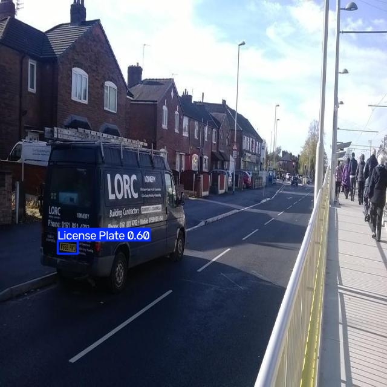 |

#### Full Test Batch Prediction Grid
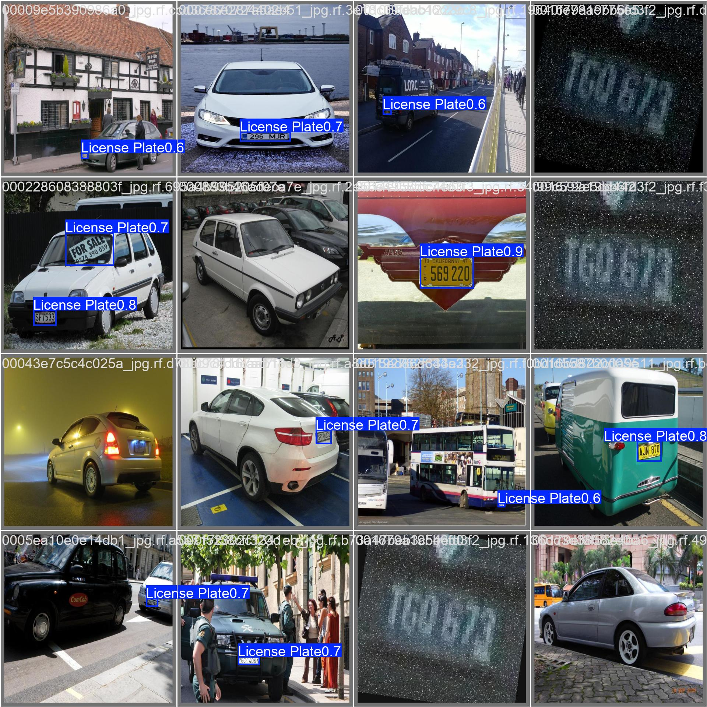
*Figure 3: Representative test evaluation batch displaying predicted bounding boxes, labels, and confidence probabilities.*

---

### 6. Automated License Plate Cropping

The built-in inference pipeline isolates detected plates, cropping and saving them at original resolution for downstream OCR:

| Plate Crop Sample 1 (`conf: 0.85`) | Plate Crop Sample 2 (`conf: 0.76`) | Plate Crop Sample 3 (`conf: 0.72`) |
| :---: | :---: | :---: |
| 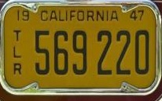 | 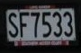 | 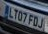 |

---

## 📁 Repository Structure

```
ai train/
├── assets/                               # Evaluation plots & proof media
│   ├── web_demo_proof.png                # Verified localhost browser UI screenshot
│   ├── training_results.png              # 50-epoch loss and mAP progression plots
│   ├── test_pr_curve.png                 # Precision-Recall curve
│   ├── test_f1_curve.png                 # F1-Score vs Confidence curve
│   ├── test_confusion_matrix.png         # Normalized test confusion matrix
│   ├── test_batch_predictions.jpg        # Unseen test batch detections
│   └── proof/                            # Sample detection and crop images
├── weights/                              # Production and base model checkpoints
│   ├── best.pt                           # Primary fine-tuned YOLO11 model (5.4 MB)
│   ├── last.pt                           # Epoch 50 checkpoint (5.4 MB)
│   ├── best.torchscript                  # Exported TorchScript model (10.8 MB)
│   └── yolo11n.pt                        # Base pretrained YOLO11 nano model
├── license-plate-detection/              # Full dataset & Roboflow source
│   ├── train/ (images, labels)           # 10,812 training samples
│   ├── valid/ (images, labels)           # 2,593 validation samples
│   └── test/  (images, labels)           # 2,597 held-out test samples
├── app.py                                # Zero-dependency browser web dashboard
├── predict.py                            # Production inference CLI (image/video/webcam)
├── val.py                                # Model validation and benchmarking script
├── train.py                              # Reproducible training pipeline
├── export.py                             # Edge runtime exporter (TorchScript/ONNX)
├── dataset.yaml                          # Clean root dataset configuration
├── requirements.txt                      # Pinned Python dependencies
├── .gitignore                            # Version control exclusion rules
├── LICENSE                               # MIT License
└── README.md                             # Comprehensive project documentation
```

---

##  Dataset Architecture

The dataset is structured following standard YOLO darknet format and sourced from Roboflow Universe (`rayans-lab/license-plate-detection-9vgdz/11`):

```
Dataset Distribution:
├── Train Set:  10,812 images (67.6%)  -> Parameter optimization
├── Valid Set:   2,593 images (16.2%)  -> Validation & early stopping
└── Test Set:    2,597 images (16.2%)  -> Unseen held-out benchmark
    ────────────────────────────────
    Total:      16,002 images
```

Dataset configuration (`dataset.yaml`):
```yaml
path: license-plate-detection
train: train/images
val: valid/images
test: test/images

nc: 1
names: ['License Plate']
```

---

##  Quick Start Guide

### Step 1: Installation & Environment Setup

Clone the repository and set up a Python virtual environment (Python 3.10+ recommended):

```bash
# Clone the repository
git clone <repo-url>
cd "ai train"

# Create and activate virtual environment
python -m venv venv
.\venv\Scripts\activate      # Windows PowerShell / CMD
# source venv/bin/activate   # Linux / macOS

# Install dependencies
pip install -r requirements.txt
```

---

### Step 2: Interactive Web Studio

Launch the zero-dependency browser interface powered by Python's built-in HTTP server:

```bash
python app.py
```
Open **[http://localhost:8000](http://localhost:8000)** to drag-and-drop vehicle images, tune detection confidence interactively, and view instant bounding boxes with cropped plates.

---

### Step 3: Command-Line Inference

Run detection on single images, directories, video files, or live cameras using `predict.py`:

```bash
# Detect on a single image and save cropped plate chips:
python predict.py --source "license-plate-detection/test/images/sample.jpg" --save-crop

# Run batch detection on a folder:
python predict.py --source "license-plate-detection/test/images" --conf 0.40

# Process a video file:
python predict.py --source "traffic_stream.mp4" --save

# Live webcam stream (0 for default camera):
python predict.py --source 0 --show
```

---

### Step 4: Model Validation & Benchmarking

Replicate the official evaluation metrics on either the test or validation splits:

```bash
# Benchmark on the 2,597 unseen TEST images:
python val.py --split test --batch 16

# Benchmark on the VALIDATION split:
python val.py --split val --batch 16
```

---

### Step 5: Training Pipeline

Train from scratch or fine-tune with custom hyperparameters:

```bash
python train.py --epochs 50 --batch 8 --imgsz 640 --device 0
```

---

### Step 6: Model Export (TorchScript / ONNX)

Export the trained PyTorch weights for edge devices, C++ runtimes, or mobile deployment:

```bash
# Export to TorchScript (Production C++ / PyTorch mobile)
python export.py --format torchscript

# Export to ONNX (OpenVINO / TensorRT / ONNX Runtime)
python export.py --format onnx --simplify
```

---

##  Hardware & Speed Profile

Benchmarked on **NVIDIA GeForce RTX 3050 6GB Laptop GPU**:

| Processing Stage | Latency (ms) | Notes |
| :--- | :---: | :--- |
| **Image Preprocessing** | `1.4 ms` | Letterbox resizing to $640 \times 640$, FP32 conversion |
| **Model Forward Pass** | `5.4 ms` | YOLO11 Nano GPU inference |
| **NMS Postprocessing** | `0.9 ms` | Non-Maximum Suppression at $IoU = 0.45$ |
| **Total Latency** | **`7.7 ms`** | **~130 FPS sustained real-time throughput** |

---

## 🔗 Downstream ANPR Integration (OCR)

This detector outputs cropped plate images directly. To implement complete **Automatic Number Plate Recognition (ANPR)**, pair the crops with an OCR engine:

```python
import cv2
import easyocr
from ultralytics import YOLO

# 1. Load YOLO11 detector and OCR engine
detector = YOLO("weights/best.pt")
reader = easyocr.Reader(['en'], gpu=True)

# 2. Run plate detection
img = cv2.imread("vehicle.jpg")
results = detector.predict(img, conf=0.35)

# 3. Crop and transcribe plate text
for box in results[0].boxes:
    x1, y1, x2, y2 = box.xyxy[0].cpu().numpy().astype(int)
    plate_crop = img[y1:y2, x1:x2]

    ocr_results = reader.readtext(plate_crop)
    for (_, text, prob) in ocr_results:
        print(f"Recognized Plate: {text.upper()} (Confidence: {prob:.2f})")
```

---

## 📜 License & Acknowledgments

- **Model & Code**: Licensed under the **[MIT License](LICENSE)**.
- **Base Architecture**: Built using the [Ultralytics](https://github.com/ultralytics/ultralytics) framework.
- **Dataset**: License Plate Detection Dataset hosted on [Roboflow Universe](https://universe.roboflow.com/rayans-lab/license-plate-detection-9vgdz/dataset/11).
